# CCA 3 - Computer Vision Practical Assignment (Units 3, 4 and 5)

**Student:** Payal Pase  
**Roll no / Division / Batch:** 1272250520 / C / 2  
**Course:** MCA, MIT-WPU  

**Git repository URL:** 

**Project explanation video (Google Drive link):** https://drive.google.com/file/d/uV61LuVZPDmAPbcCEC393qDNvzpX0hG/view?usp=sharing

## 1. Aim

To implement image restoration, segmentation, feature extraction, object recognition and motion estimation techniques in Python (OpenCV, NumPy, Matplotlib, scikit-image, Ultralytics YOLO) on my own photographs and self-recorded video.

## 2. Input Data

| Input | File | Details |
|---|---|---|
| photo1 (original photograph) | Photo1.jpeg | working size 1000x1000 |
| photo2 (second photograph) | photo2.jpeg | working size 600x800 |
| video (original) | video.mp4 | 768x576, 10.0 fps, 6.0 s |

Original, unedited files are stored in the `input/` folder (video also on Google Drive). Large photos are shrunk (longest side <= 1000 px) only for processing speed.

**Description of the photographs and video (where/what I captured):** >>> FILL IN <<<

## 3. Source Code

| Task | File |
|---|---|
| Task 1 - restoration, morphology, Canny, watershed | `src/task1_restoration_segmentation.py` |
| Task 2 - HOG, SIFT, matching | `src/task2_feature_matching.py` |
| Task 3 - Haar cascade and YOLO | `src/task3_object_detection.py` |
| Task 4 - frame differencing, GMM, Lucas-Kanade | `src/task4_motion_estimation.py` |
| Runner / report | `main.py`, `src/generate_report.py` |

## 4. Task 1 - Image Restoration and Segmentation (Unit 3)

### 4.1 Image restoration

Gaussian noise (sigma = 25) and salt-and-pepper noise (5 % of pixels) were added to `Photo1.jpeg`. Both noisy images were restored with a 5x5 median filter and a 5x5 Gaussian filter and compared with the clean original using PSNR (dB, higher is better) and SSIM (0 to 1, higher is better).

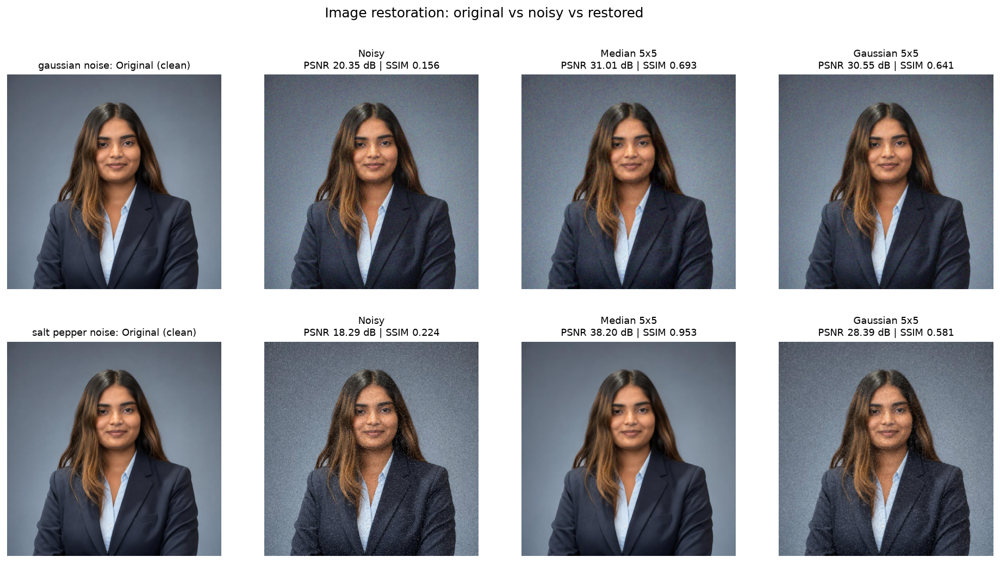

*Figure 1: Original, noisy and restored images with PSNR/SSIM*

| Noise | Method | PSNR (dB) | SSIM |
|---|---|---|---|
| gaussian_noise | none (noisy image) | 20.35 | 0.1555 |
| gaussian_noise | median filter 5x5 | 31.01 | 0.6932 |
| gaussian_noise | gaussian filter 5x5 | 30.55 | 0.6414 |
| salt_pepper_noise | none (noisy image) | 18.29 | 0.2237 |
| salt_pepper_noise | median filter 5x5 | 38.20 | 0.9534 |
| salt_pepper_noise | gaussian filter 5x5 | 28.39 | 0.5812 |

* **gaussian_noise**: best PSNR -> median filter 5x5; best SSIM -> median filter 5x5.

* **salt_pepper_noise**: best PSNR -> median filter 5x5; best SSIM -> median filter 5x5.

**My observation:** >>> FILL IN <<< (look at Figure 1: which filter keeps edges sharper? which removes the white/black dots completely?)

### 4.2 Thresholding, morphology and Canny edges

Otsu's method chose threshold 84. The mask was inverted so objects are white. Morphology used a 5x5 ellipse kernel.

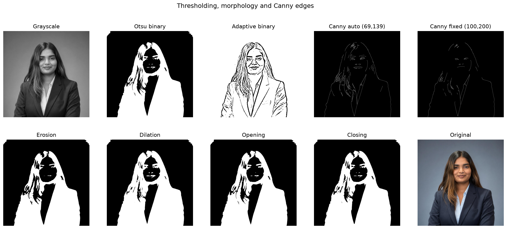

*Figure 2: Binary images, morphological operations and Canny edge maps*

| Result | White pixels (%) |
|---|---|
| Otsu binary | 35.68 |
| Erosion | 33.51 |
| Dilation | 37.80 |
| Opening | 35.43 |
| Closing | 36.01 |

| Canny setting | Edge pixels (%) |
|---|---|
| auto thresholds (69, 139) | 1.05 |
| fixed thresholds (100, 200) | 0.52 |

**My observation:** >>> FILL IN <<< (erosion shrinks objects / removes small white noise; dilation grows them; opening removes small specks; closing fills small holes.)

### 4.3 Watershed segmentation

Image used: `Photo1.jpeg`. Number of regions found: **2**.

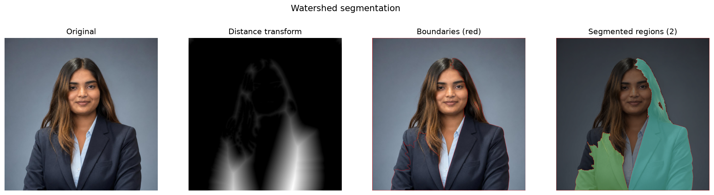

*Figure 3: Watershed segmentation*

**My observation:** >>> FILL IN <<< (did it separate touching objects correctly? any over/under-segmentation?)

### 4.4 Which techniques worked best?

>>> FILL IN <<< (write 3-4 lines using the tables above, e.g. best filter per noise type and why.)

## 5. Task 2 - Feature Extraction and Image Matching (Unit 4)

### 5.1 HOG features

HOG parameters: {'orientations': 9, 'pixels_per_cell': [16, 16], 'cells_per_block': [2, 2]}. Feature-vector length: photo1 = 8100, photo2 = 5940.

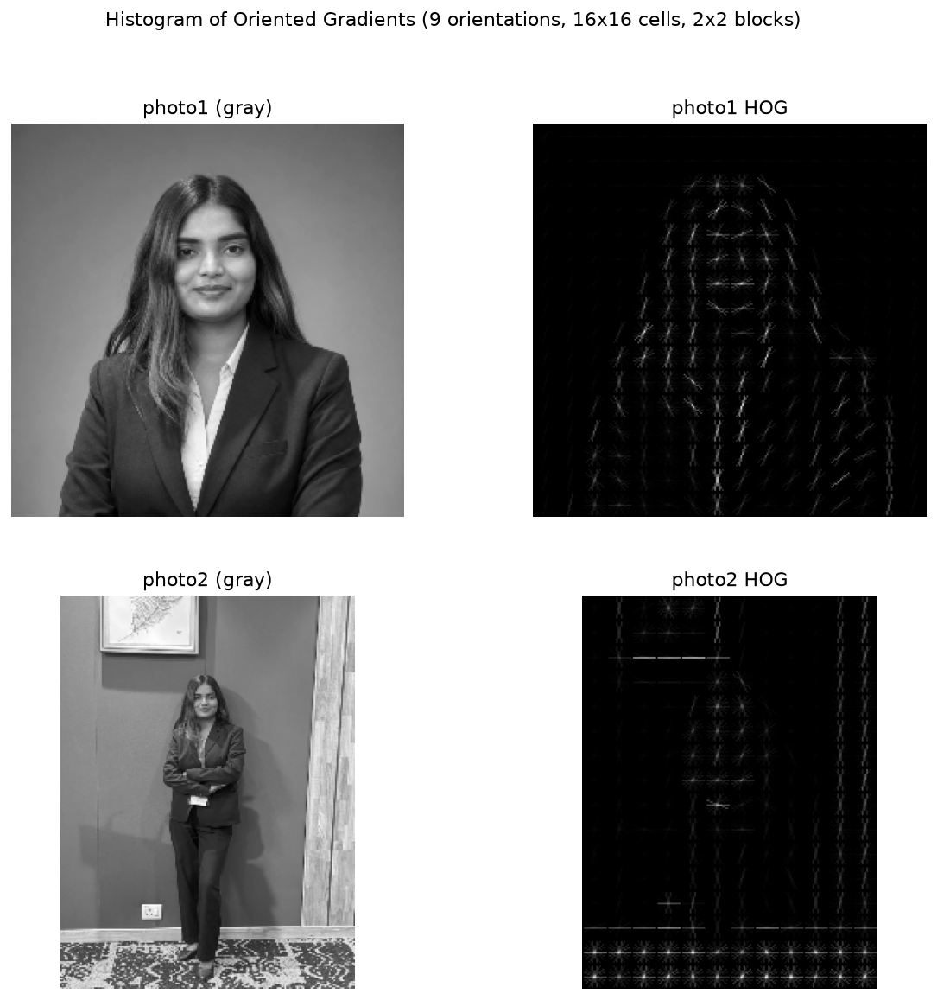

*Figure 4: HOG visualisation of both photographs*

### 5.2 SIFT keypoints and descriptors

SIFT keypoints: photo1 = 542, photo2 = 2003. Each descriptor has 128 values.

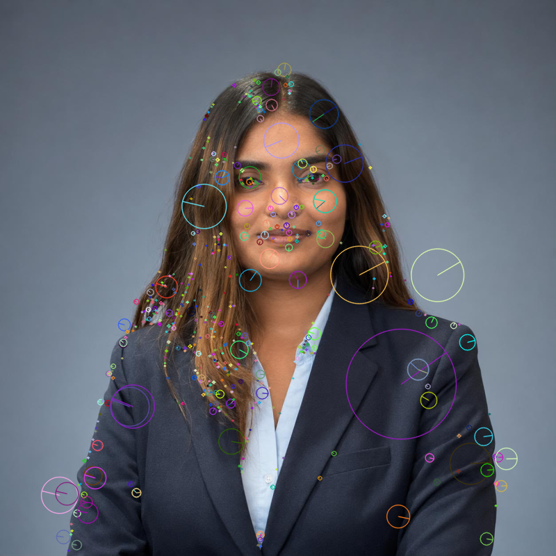

*Figure 5: SIFT keypoints - photo1*

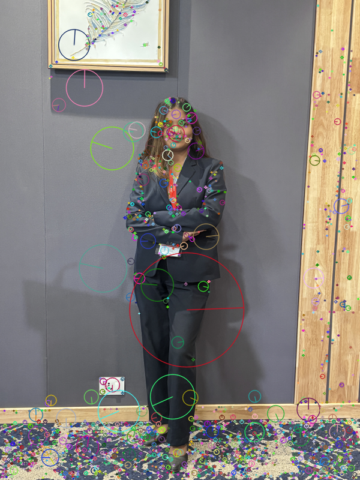

*Figure 6: SIFT keypoints - photo2*

### 5.3 Matching and robustness test

Matching: brute-force L2, Lowe ratio test (0.75), then RANSAC homography (threshold 5.0 px) to count geometrically consistent inliers.

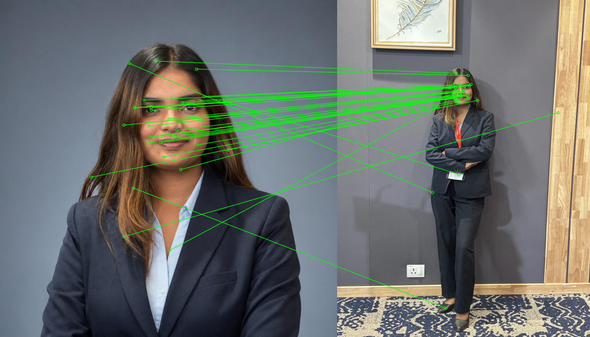

*Figure 7: photo1 vs photo2 (no change)*

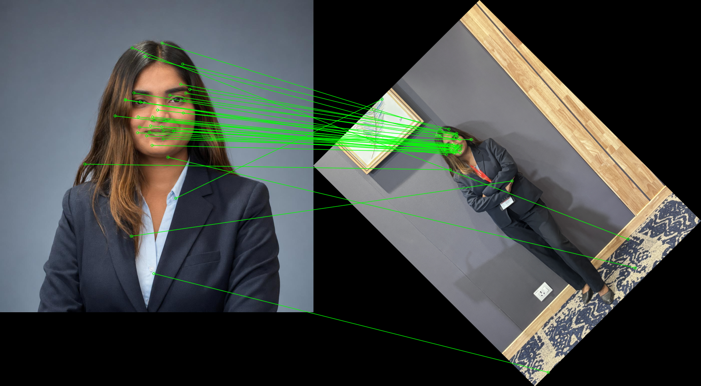

*Figure 8: photo2 rotated by 45 degrees*

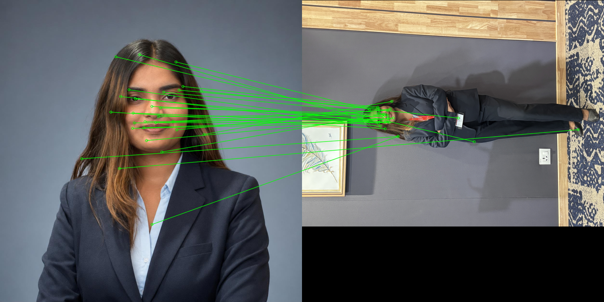

*Figure 9: photo2 rotated by 90 degrees*

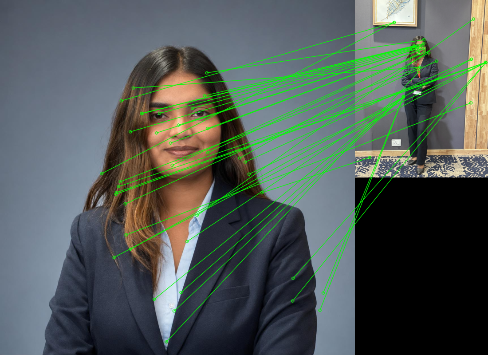

*Figure 10: photo2 resized to 50 %*

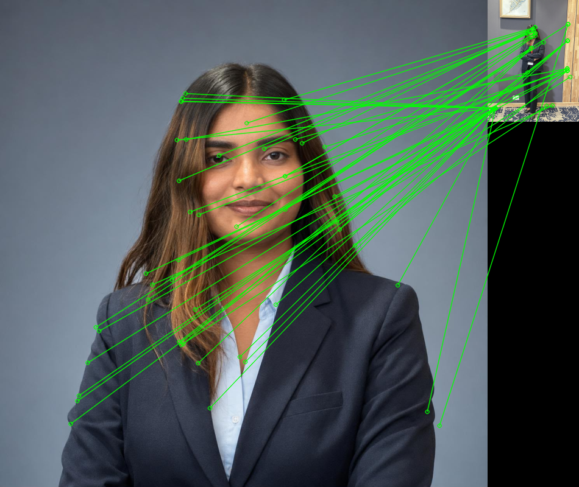

*Figure 11: photo2 resized to 25 %*

| Experiment | KP photo1 | KP photo2 variant | Good matches | RANSAC inliers | Inlier % | Time (ms) |
|---|---|---|---|---|---|---|
| original | 542 | 2003 | 32 | 26 | 81.2 | 12.9 |
| rotated_45 | 542 | 2438 | 37 | 32 | 86.5 | 7.1 |
| rotated_90 | 542 | 2007 | 28 | 23 | 82.1 | 6.3 |
| resized_50pct | 542 | 624 | 39 | 16 | 41.0 | 9.3 |
| resized_25pct | 542 | 167 | 47 | 15 | 31.9 | 22.1 |

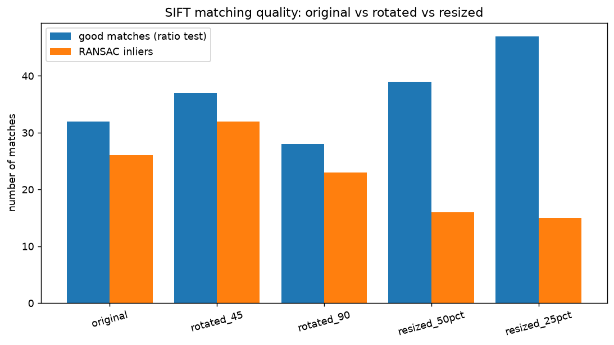

*Figure 12: Matching comparison chart*

From the table: most inliers in **rotated_45** (32), fewest in **resized_25pct** (15).

**My observation:** >>> FILL IN <<< (SIFT is designed to be scale/rotation invariant - do your numbers support that? why does matching drop for 25 % size?)

## 6. Task 3 - Object Recognition: Viola-Jones vs YOLO (Unit 5)

Haar model: `haarcascade_frontalface_default.xml` (pretrained, OpenCV). YOLO model: `yolov8n.pt` (pretrained, confidence threshold 0.25).

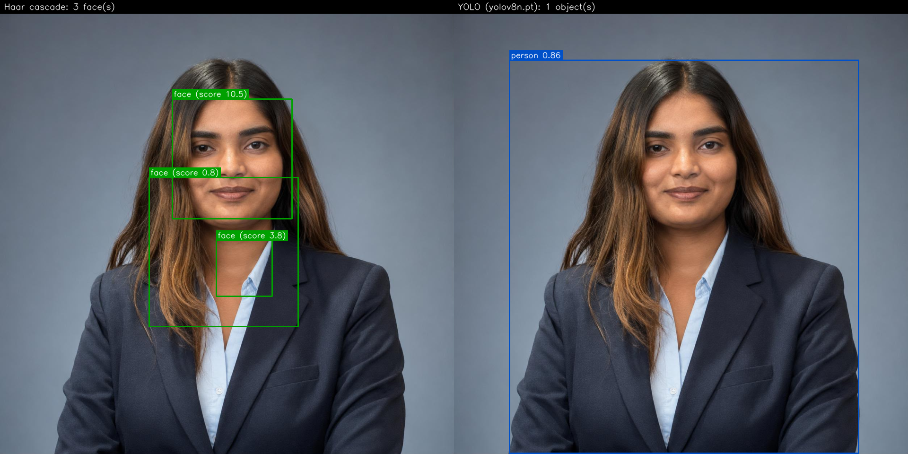

*Detection comparison on photo1 (left: Haar, right: YOLO)*

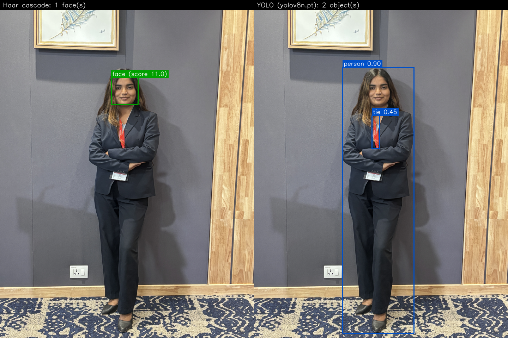

*Detection comparison on photo2 (left: Haar, right: YOLO)*

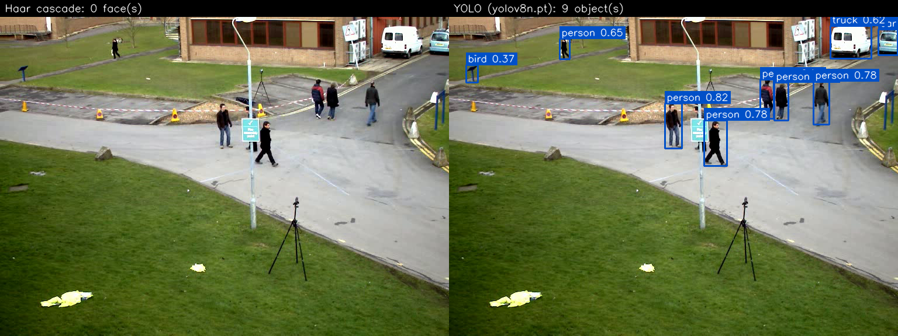

*Detection comparison on video_frame_12 (left: Haar, right: YOLO)*

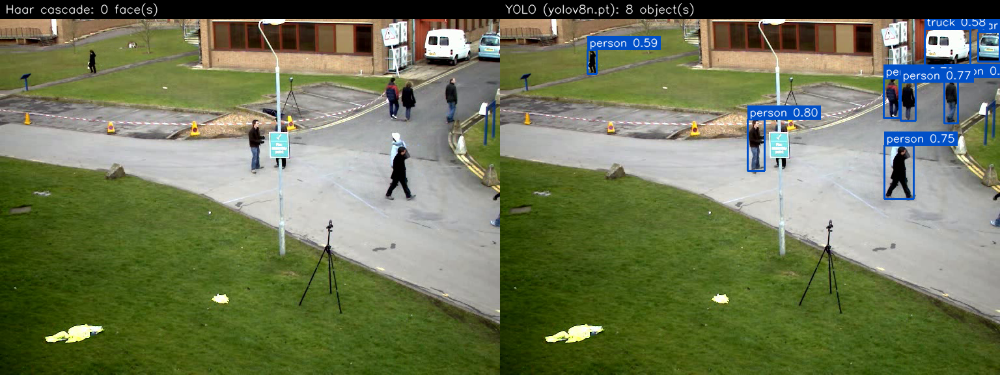

*Detection comparison on video_frame_30 (left: Haar, right: YOLO)*

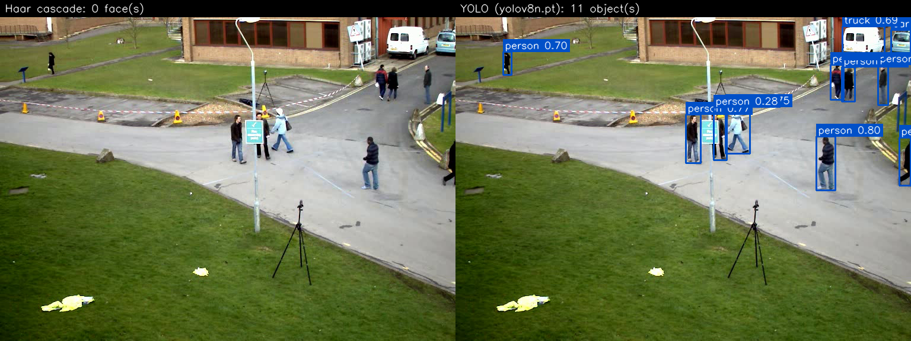

*Detection comparison on video_frame_48 (left: Haar, right: YOLO)*

| Source | Haar faces | Haar ms | YOLO objects | YOLO classes | Avg YOLO conf | YOLO ms |
|---|---|---|---|---|---|---|
| photo1 | 3 | 554.5 | 1 | {'person': 1} | 0.864 | 3683.3 |
| photo2 | 1 | 119.5 | 2 | {'person': 1, 'tie': 1} | 0.676 | 108.3 |
| video_frame_12 | 0 | 123.2 | 9 | {'person': 6, 'car': 1, 'truck': 1, 'bird': 1} | 0.708 | 97.5 |
| video_frame_30 | 0 | 141.0 | 8 | {'person': 6, 'car': 1, 'truck': 1} | 0.723 | 77.6 |
| video_frame_48 | 0 | 145.7 | 11 | {'person': 9, 'car': 1, 'truck': 1} | 0.662 | 67.5 |

### Possible missed / incorrect detections (automatic hints - verify with your eyes)

* **photo2**: 1 YOLO detection(s) have confidence < 0.50 (check if they are wrong): tie 0.45

* **video_frame_12**: YOLO sees a person but Haar found no face (Haar may have missed it, or the face is small/turned away).

* **video_frame_12**: 1 YOLO detection(s) have confidence < 0.50 (check if they are wrong): bird 0.37

* **video_frame_30**: YOLO sees a person but Haar found no face (Haar may have missed it, or the face is small/turned away).

* **video_frame_48**: YOLO sees a person but Haar found no face (Haar may have missed it, or the face is small/turned away).

* **video_frame_48**: 2 YOLO detection(s) have confidence < 0.50 (check if they are wrong): person 0.39, person 0.28

**My observation (required: at least one miss/wrong detection, if encountered):** >>> FILL IN <<<

**Comparison of the two approaches:** >>> FILL IN <<< (Haar: fast, only faces, no class names, many false positives; YOLO: many classes, confidence scores, more robust but heavier.)

## 7. Task 4 - Video Motion Estimation (Unit 5)

Video `video.mp4`: 768x576, 10.0 fps, 60 frames, 6.0 s. Frames were resized to width 640 px for processing.

### 7.1 Consecutive frames

*Consecutive frame 30*

*Consecutive frame 31*

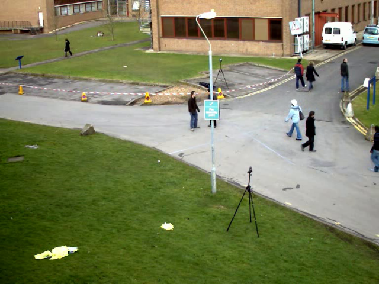

*Consecutive frame 32*

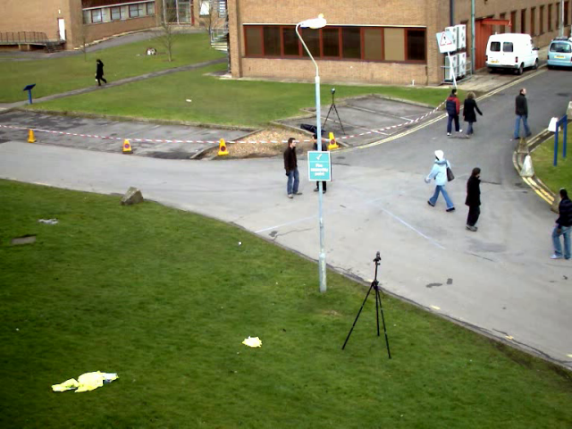

*Consecutive frame 33*

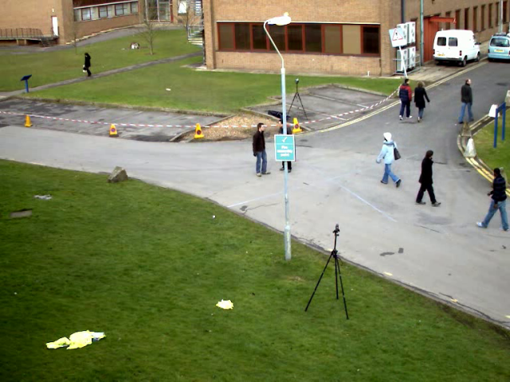

*Consecutive frame 34*

*Consecutive frame 35*

### 7.2 Masks and motion vectors (original | frame difference / GMM mask | Lucas-Kanade vectors)

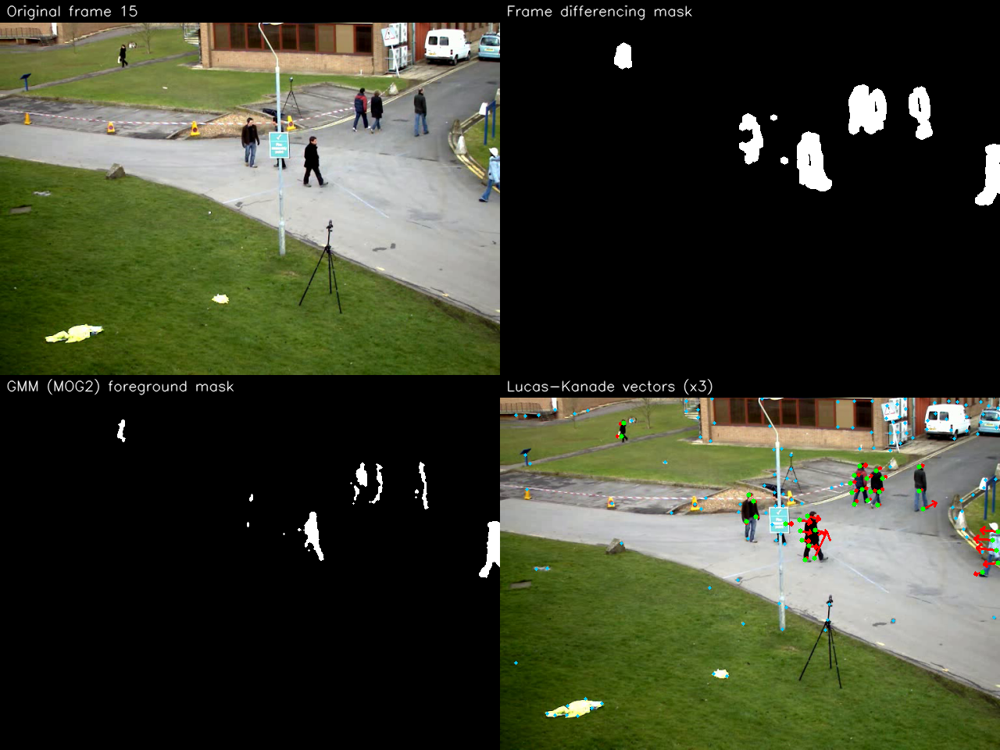

*Frame 15: original, frame-differencing mask, GMM foreground mask, LK vectors (arrows x3)*

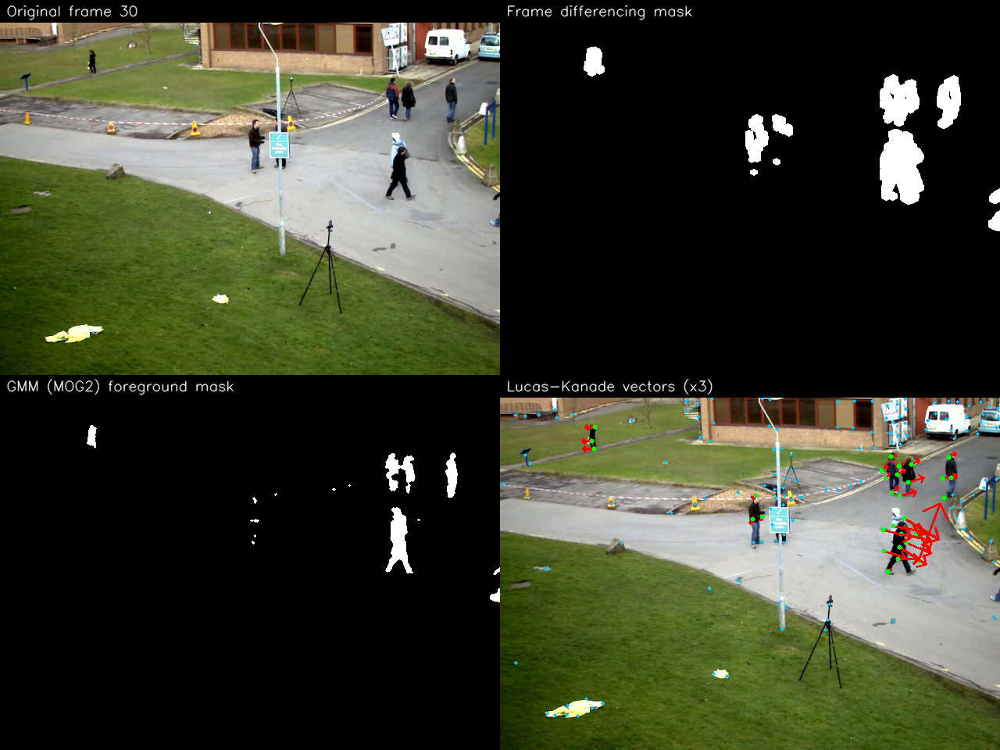

*Frame 30: original, frame-differencing mask, GMM foreground mask, LK vectors (arrows x3)*

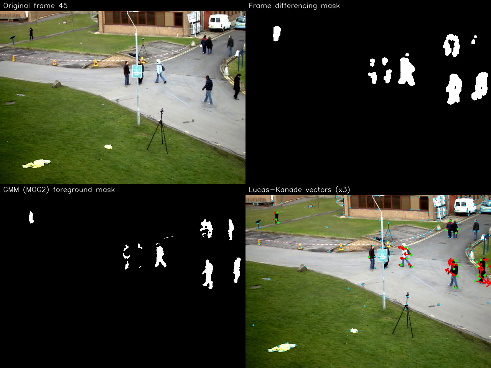

*Frame 45: original, frame-differencing mask, GMM foreground mask, LK vectors (arrows x3)*

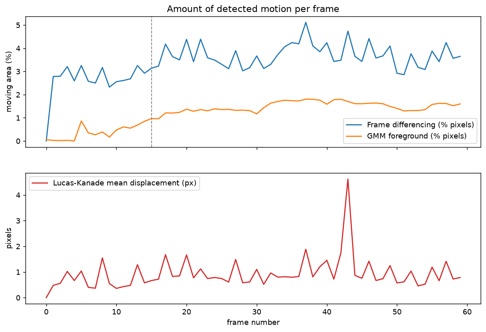

*Detected motion over time*

### 7.3 Comparison table (measured on your video)

| Technique | Output | Avg moving value | Avg time (ms/frame) | Notes |
|---|---|---|---|---|
| Frame differencing | binary motion mask | 3.69 | 0.32 | needs previous frame only |
| GMM background subtraction (MOG2) | binary foreground mask | 1.48 | 7.73 | first ~15 frames skipped (background learning) |
| Lucas-Kanade optical flow | motion vectors at corner points | 17.51 | 12.16 | avg tracked points 200, avg displacement 1.02px; value = % of points moving > 1px (not area) |

Average overlap (IoU) between the frame-differencing mask and the GMM mask: **0.36** (1.0 = identical masks).

**My observation:** >>> FILL IN <<< (look at the panels: does frame differencing only show edges of the moving object? does GMM fill the whole object? do the LK arrows point in the direction of motion?)

## 8. Conclusion

>>> FILL IN <<< (5-8 lines: what you implemented, the best filter, how SIFT behaved under rotation/resizing, Haar vs YOLO, and which motion technique suited your video, quoting numbers from the tables above.)

## 9. Submission checklist

- [ ] Original photo1, photo2 and video submitted
- [ ] Git repository pushed and URL written above
- [ ] Repository access given to rahul.inchal.inchal24@gmail.com and rahul.inchal.vf@mitwpu.edu.in
- [ ] Explanation video (5-8 min) uploaded to the Google Drive folder and link written above
- [ ] All `>>> FILL IN <<<` markers in this report replaced
